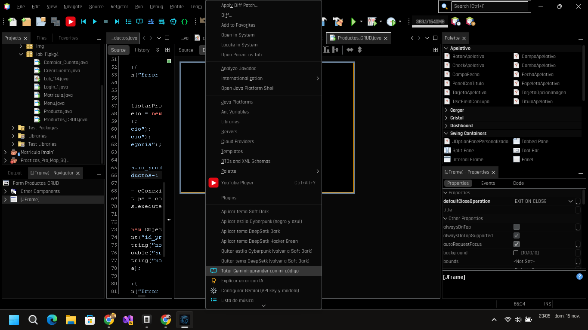
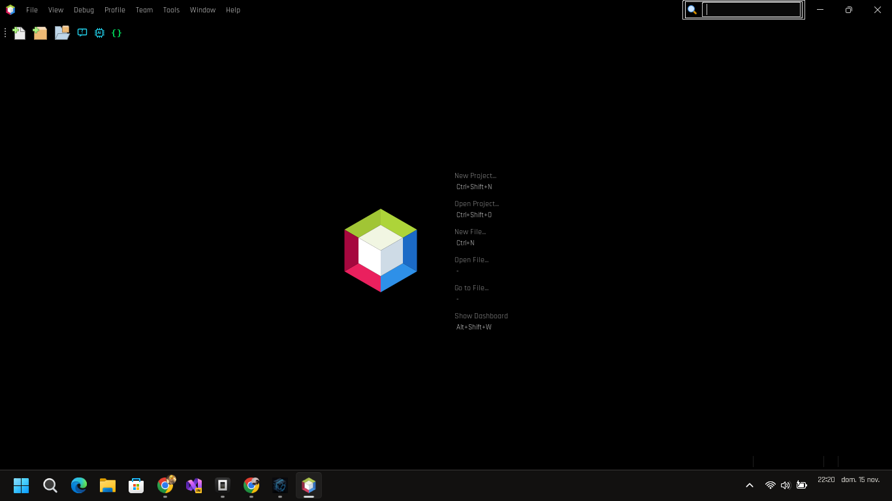
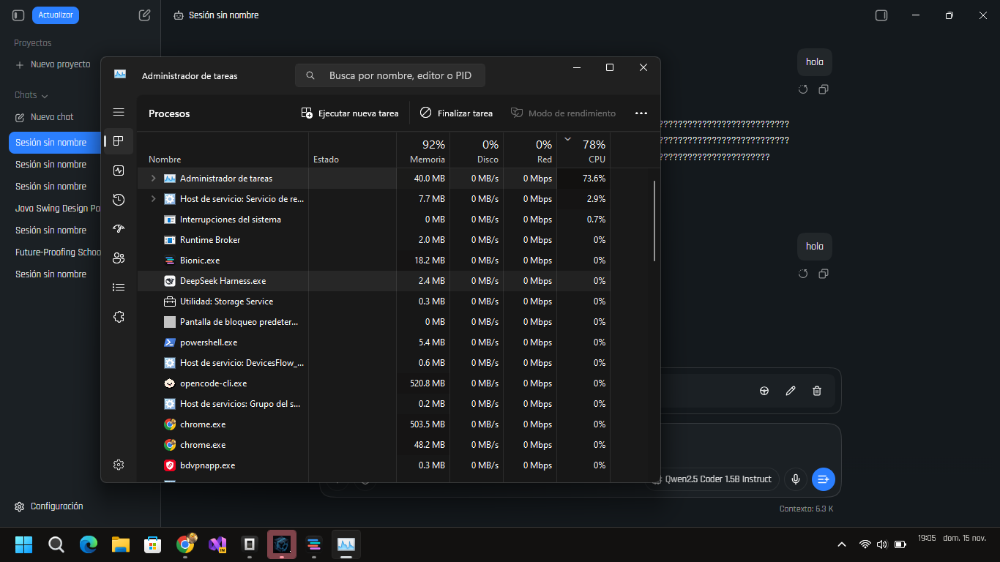
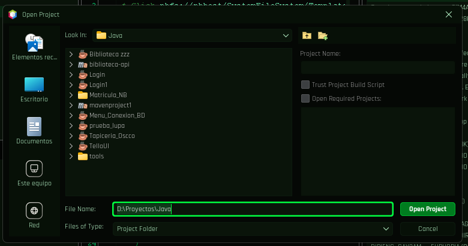
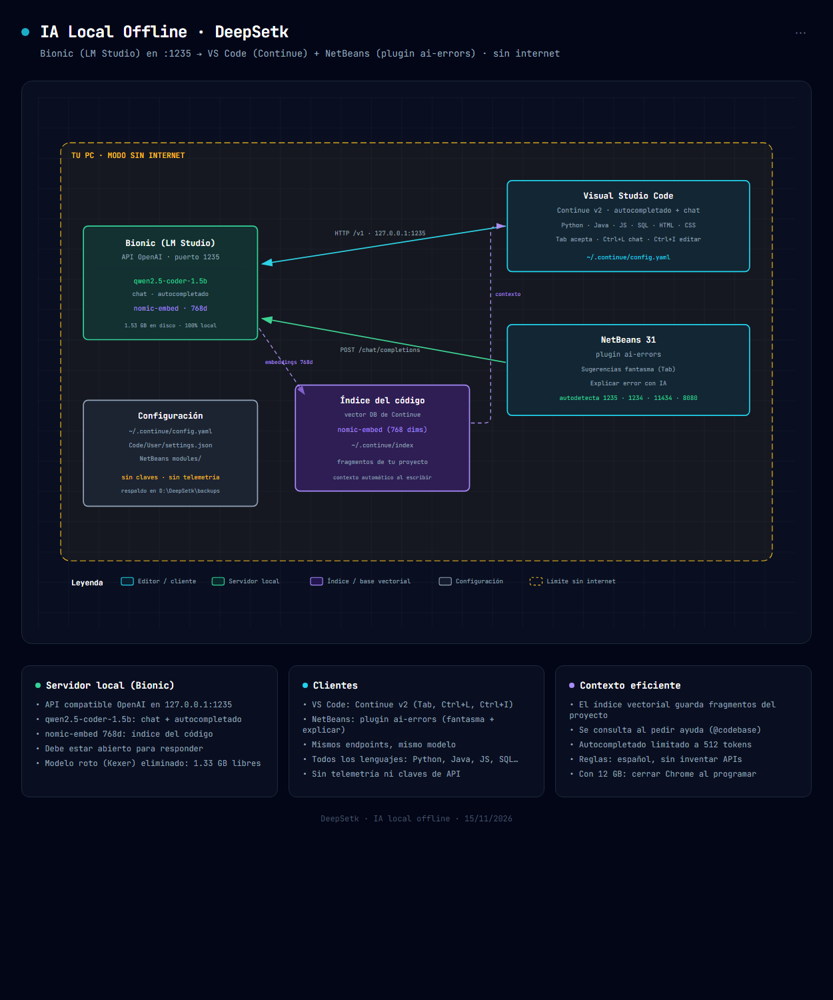

# Capturas — cómo se ve y cómo funciona

Todas las capturas son de un NetBeans 31 real con los plugins instalados.

## 1. Menú Herramientas: todo el plugin

Desde **Tools** se accede a todo:

| Acción | Qué hace |
|---|---|
| Aplicar tema Soft Dark | Tema base |
| Aplicar estilo Cyberpunk (negro y azul) | Tema cyberpunk |
| **Aplicar tema DeepSetk Dark** | Negro puro, selección gris |
| **Aplicar tema DeepSetk Hacker Green** | Verde neón |
| Tutor Gemini: aprender con mi código | Asistente con el código abierto |
| **Explicar error con IA** | Usa la IA local (Bionic :1235) o Gemini |
| Configurar Gemini / Configurar LLM local | Ajustes de proveedor |
| **Sugerencias fantasma (Tab)** | Autocompletado inline |
| **Pedir sugerencia IA ahora** | `Ctrl+Alt+Espacio` |
| Lista de música / YouTube Player | Módulos extra |

## 2. Tema DeepSetk Dark aplicado en un perfil limpio

Fondo `#000000`, menús negros, sin azules. Esta captura es de un **userdir vacío**
(NetBeans recién instalado), así que confirma que el tema arranca aplicado.

## 3. Editor con el tema

Pestañas, barra de herramientas, árbol de proyectos, gutter y línea actual con la
paleta del tema.

## 4. Diálogos de NetBeans

El diálogo *Open Project* también queda tematizado (barra de título, panel lateral
de accesos, lista, botón por defecto y borde de foco).

## 5. Arquitectura de la IA local

Bionic (LM Studio) en `127.0.0.1:1235` sirviendo a VS Code, NetBeans y Visual Studio,
con el índice vectorial del código. Versión interactiva: `ia-local-arquitectura.html`.
